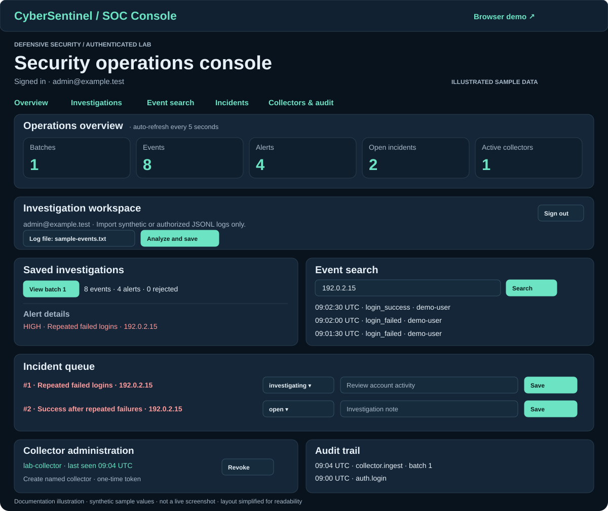
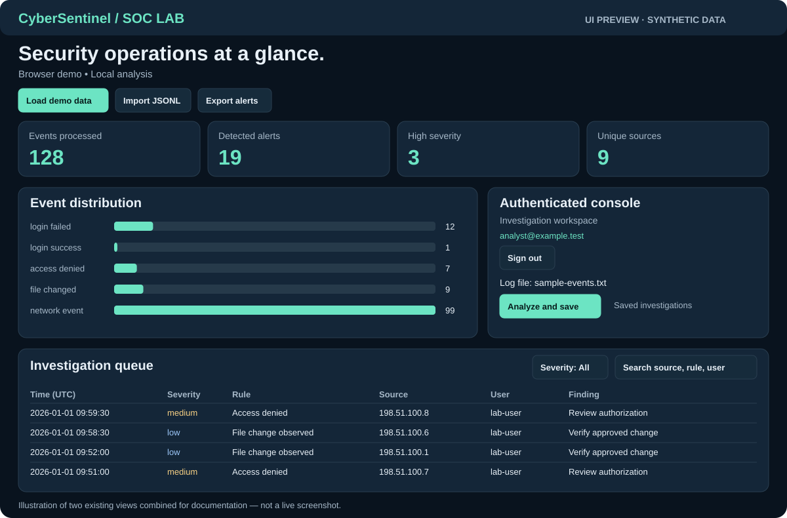
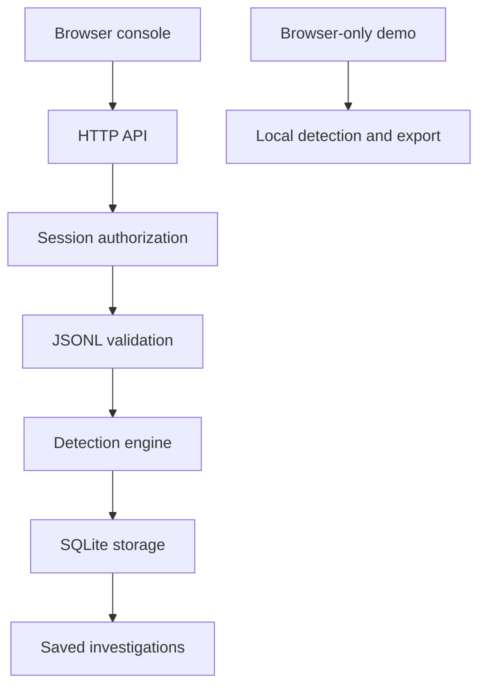

# CyberSentinel SOC

**Security Operations Center & Threat Detection Lab**

A lightweight, self-hosted security event analysis platform for cybersecurity learners, SOC analyst training and defensive security portfolios. It combines a browser-based dashboard, authenticated investigation console, rule-based detection engine and local SQLite persistence. No paid API, cloud account or third-party npm dependencies are required.


## Enterprise-oriented development release

The authenticated console now includes polling-based operations metrics, indexed event search, high-severity incident lifecycle, owner-scoped analyst/admin permissions, revocable collector credentials, machine ingestion with idempotency, and account audit history. A lightweight Docker Compose configuration and Windows/Linux/macOS CI matrix are included. See [Operations and collector setup](docs/OPERATIONS.md) for exact steps, API details and limitations.

Create an administrator by adding `admin` after the email in the account-creation command, e.g. `node server/start.mjs create-user admin@example.test admin`. Existing accounts remain analysts.

## UI preview



*Illustrated preview of the current authenticated operations console with synthetic sample values. Layout is simplified for readability; not a live screenshot.*

<details>
<summary>Browser demo dashboard preview</summary>



</details>

- **[Features](#features)** · **[Installation](#installation)** · **[How to use](#how-to-use)** · **[Architecture](#architecture)** · **[Troubleshooting](#troubleshooting)**

## Features

| Module | What it does |
| --- | --- |
| Security dashboard | Browser demo displays processed event count, detected alerts, high-severity alerts, unique sources and an event-distribution chart. |
| Log ingestion | Accepts newline-delimited JSON (JSONL/NDJSON) files, validates required fields, normalizes timestamps and counts rejected rows. |
| Threat detection | Detects repeated login failures, success after repeated failures, access denial and file changes. |
| Investigation queue | Browser demo supports severity filters, text search and JSON alert export. |
| Authenticated console | Sign in, upload logs for server-side analysis, view saved investigations and inspect individual batch alerts. |
| Persistent storage | SQLite stores uploaded valid events, alerts, users and session hashes; investigations remain after restart. |
| Access isolation | Each authenticated account can access only its own investigation batches. |
| Training mode | Built-in 128-event synthetic demo runs entirely in the browser without uploading logs. |

### Detection rules

| Rule | Severity | Trigger |
| --- | --- | --- |
| Repeated failed logins | High | Five or more failures for the same source and user within five minutes; repeat alert suppressed for five minutes. |
| Success after repeated failures | High | A successful login after at least five matching failures within five minutes. |
| Access denied | Medium | An event of type `access_denied`. |
| File change observed | Low | An event of type `file_changed`. |

Alerts are indicators for investigation, not proof of an intrusion. Network events are counted, not automatically classified as malicious. Detection is limited to each imported batch.

## Installation

### Requirements

- Node.js **22.13 or newer** (Node.js 22 LTS recommended), with npm included. Download from [nodejs.org](https://nodejs.org/en/download).
- Git, available from [git-scm.com](https://git-scm.com/downloads).
- A modern browser (Chrome, Edge, Firefox or Safari).
- No separate SQLite server, Docker, Python or API key is required.

The following commands install the authenticated foundation from its development branch. Run commands in the stated shell. If you already cloned the project, switch to this branch instead of cloning twice. Account creation is a one-time operation.

### Windows (PowerShell)

Install Node.js and Git using their official installers, or run these commands if Windows Package Manager is installed:

```powershell
winget install --id OpenJS.NodeJS.LTS -e
winget install --id Git.Git -e
```

Reopen PowerShell after installation. Verify Node is at least 22.13.

```powershell
node --version
git --version
git clone --branch industry-soc-foundation https://github.com/0xpratikparmar/cyber-sentinel-soc.git
cd cyber-sentinel-soc
```

Create your account with a unique password of at least 12 characters. The prompt hides the password; do not paste a password directly into shell history.

```powershell
$secure = Read-Host "New password (12+ characters)" -AsSecureString
$ptr = [Runtime.InteropServices.Marshal]::SecureStringToBSTR($secure)
try {
    $env:SOC_PASSWORD = [Runtime.InteropServices.Marshal]::PtrToStringBSTR($ptr)
    node server/start.mjs create-user analyst@example.test
} finally {
    Remove-Item Env:SOC_PASSWORD -ErrorAction SilentlyContinue
    [Runtime.InteropServices.Marshal]::ZeroFreeBSTR($ptr)
    $secure.Dispose()
}
node server/start.mjs
```

Open [http://127.0.0.1:8000](http://127.0.0.1:8000). Using Node directly also avoids PowerShell execution-policy issues with npm.ps1. To run tests, use `npm.cmd test` in another PowerShell window in the project directory.

### Linux (Ubuntu, Debian, Kali and other distributions)

Install Git via your distribution package manager. On Ubuntu, Debian or Kali:

```bash
sudo apt update
sudo apt install -y git
```

Install Node.js 22.13+ using the [official Node.js download instructions](https://nodejs.org/en/download) for your distribution and CPU architecture. Distribution repositories may ship older Node versions. Then open Bash and run:

```bash
node --version
git --version
git clone --branch industry-soc-foundation https://github.com/0xpratikparmar/cyber-sentinel-soc.git
cd cyber-sentinel-soc
printf 'New password (12+ characters): '
read -rs SOC_PASSWORD
printf '\n'
export SOC_PASSWORD
node server/start.mjs create-user analyst@example.test
unset SOC_PASSWORD
npm start
```

Open [http://127.0.0.1:8000](http://127.0.0.1:8000). Use `npm test` to run the automated tests from a second terminal.

### macOS (Apple Silicon and Intel)

Install Node.js 22.13+ and Git using the official installers above. If Homebrew is already installed, you can instead use:

```bash
brew install node@22 git
export PATH="$(brew --prefix node@22)/bin:$PATH"
```

Run the following in Terminal (Zsh or Bash):

```bash
node --version
git --version
git clone --branch industry-soc-foundation https://github.com/0xpratikparmar/cyber-sentinel-soc.git
cd cyber-sentinel-soc
printf 'New password (12+ characters): '
read -rs SOC_PASSWORD
printf '\n'
export SOC_PASSWORD
node server/start.mjs create-user analyst@example.test
unset SOC_PASSWORD
npm start
```

Open [http://127.0.0.1:8000](http://127.0.0.1:8000). Use `npm test` in a second terminal. If Homebrew Node is not found after reopening Terminal, repeat the PATH command.

### Start again later

Open a terminal in the existing project directory and run:

```bash
node server/start.mjs
```

Do not recreate your account every time. Stop the server with Ctrl+C. The local database is saved in `data/soc.sqlite`.

## How to use

### 1. Try the browser-only demo

Open [http://127.0.0.1:8000/demo](http://127.0.0.1:8000/demo) or click **Browser demo** on the login page. No account is required. Click **Load demo data** to see 128 synthetic events. Review the four metric cards and event distribution, select a severity, search by source/user/rule, and click **Export alerts** to download the complete alert list as JSON.

The demo analyzes data in browser memory only. Refreshing resets the data to the built-in demo. The displayed queue is capped at 500 matching alerts; export includes all alerts, not just filtered results.

### 2. Sign in to the authenticated console

Open [http://127.0.0.1:8000](http://127.0.0.1:8000), enter `analyst@example.test` (or your own provisioned email) and the password you created. There is no preconfigured password.

### 3. Import a sample or authorized log file

Use the bundled [sample-events.txt](examples/sample-events.txt), which contains eight synthetic JSONL events. In the console, select **Log file**, choose the file from the cloned repository, and click **Analyze and save**. Expected result: 8 valid events, 4 alerts (two high, one medium and one low), and 0 rejected rows.

Files must contain one JSON object per line, not a JSON array. Maximum input is 2 MB and the authenticated API accepts up to 10,000 valid events per batch.

```json
{"timestamp":"2026-01-01T09:00:00Z","source":"192.0.2.15","type":"login_failed","user":"demo-user","detail":"Synthetic training event"}
```

| Field | Required | Description |
| --- | --- | --- |
| timestamp | Yes | Parseable ISO date/time, preferably UTC. |
| source | Yes | Nonempty source identifier, e.g. an IP address (max 150 characters). |
| type | Yes | One of `login_failed`, `login_success`, `access_denied`, `file_changed`, `network_event`. |
| user | No | Account identifier; truncated to 120 characters. |
| detail | No | Additional context; truncated to 500 characters. |

Real Windows Event Logs, Linux syslog, firewall logs and other formats require conversion to this schema before importing. Use only logs you own or are authorized to analyze.

### 4. Investigate and interpret alerts

In **Saved investigations**, click **View batch** for the desired import. Review timestamp, severity, detection rule, source, user and finding. A high alert means prioritize review, not automatic confirmation of an attack. Compare with authorized account activity, maintenance windows and known changes before drawing conclusions.

### 5. Keep records and sign out

The authenticated console saves investigations to SQLite and displays the latest 100 batches for your account. Click **Sign out** to revoke the active session. In the separate browser demo, export alerts if you need a portable JSON file. Keep real log exports and database files private.

## Architecture



| Component | Technology |
| --- | --- |
| Frontend | HTML, CSS, JavaScript ES modules |
| Backend | Node.js native HTTP server |
| Database | SQLite via node:sqlite |
| Detection | JavaScript rule engine |
| Authentication | scrypt password hashing, opaque session cookies |
| Tests | Node.js test runner and GitHub Actions |

### Authentication

The server verifies a salted scrypt password hash and creates a random 256-bit opaque session token. Only the SHA-256 token digest is stored in the database. The browser receives an HttpOnly, SameSite=Strict cookie; Secure is set when an HTTPS origin is configured. Sessions expire after eight hours. Every authenticated batch query is scoped to the signed-in account. Logout deletes the server-side session.

See [Authentication and threat model](docs/AUTHENTICATION.md) for the full request flow, origin checks, rate limits and credential handling.

### API reference

| Method | Endpoint | Purpose |
| --- | --- | --- |
| GET | /health | Basic server health check |
| POST | /api/login | Sign in with JSON email/password |
| GET | /api/me | Current authenticated account |
| POST | /api/logout | Revoke current session |
| GET | /api/batches | List own saved batches |
| POST | /api/batches | Import JSON containing a jsonl string |
| GET | /api/batches/:id/alerts | View alerts for an owned batch |

POST requests require the configured same-origin Origin header; protected routes require a valid session cookie.

## Project structure

```text
cyber-sentinel-soc/
├── index.html              # Browser demo
├── app.mjs                 # Demo dashboard and export
├── console.html            # Login and investigation console
├── console.mjs             # Authenticated UI
├── style.css               # Shared responsive styles
├── engine.mjs              # Validation and detection rules
├── engine.test.mjs         # Detection tests and test entry point
├── server/
│   ├── start.mjs           # Server and account CLI
│   ├── http.mjs            # HTTP API
│   ├── auth.mjs            # Credential/session primitives
│   ├── store.mjs           # SQLite storage
│   └── http.test.mjs       # Authentication and API tests
├── examples/sample-events.txt
├── docs/
│   ├── AUTHENTICATION.md
│   └── images/ui-preview.svg
└── .github/workflows/test.yml
```

## Testing

```bash
npm test
```

The automated tests cover log validation, detection thresholds, correlation isolation, password hashing, session expiry, API authorization, origin rejection, account isolation and logout. See [GitHub Actions](https://github.com/0xpratikparmar/cyber-sentinel-soc/actions) for CI history. The installation guides are intended for all three desktop OSes; the CI workflow now targets Ubuntu, Windows and macOS. Check actual run results before relying on compatibility.

## Troubleshooting

| Problem | Solution |
| --- | --- |
| node or git not recognized | Install prerequisites and reopen your shell; verify versions. |
| Cannot find node:sqlite | Upgrade Node.js to 22.13+; a SQLite experimental warning on Node 22 is expected. |
| Invalid credentials | Use the account and password created locally. Check that the server runs from the same project directory. |
| User creation fails | Verify email, 12+ character password, and that the email does not already exist. |
| Origin rejected | Open exactly http://127.0.0.1:8000 instead of localhost, unless SOC_ORIGIN is configured differently. |
| Address already in use | Stop the other process or use a different PORT and open the corresponding 127.0.0.1 URL. |
| No alerts | Ensure the file contains supported event types and rule thresholds are met; try the sample file. |
| No saved batches | Import through the authenticated console, not the browser demo, and sign in to the same account. |

## Limitations and roadmap

This is an AI-assisted, industry-oriented **local defensive security lab**, not a production-ready SIEM. It does not currently provide live agents, real-time streaming, external threat intelligence, MITRE mapping, MFA, organization-wide authorization, automated remediation or vulnerability scanning. Logs are stored locally in plaintext. Public deployment requires TLS, robust authentication and authorization, audit logging, storage encryption, retention controls, load testing and independent security review. Cross-platform CI is configured; interactive installation and Docker deployment have not been independently verified.

Potential future work: structured collector integrations, shared organization roles, advanced incident workflows, threat intelligence, richer dashboard and multi-platform CI. These are roadmap items, not current capabilities.

## Author

[0xpratikparmar](https://github.com/0xpratikparmar) · AI-assisted cybersecurity portfolio project. Review, run and extend the code before presenting it as independent work.
